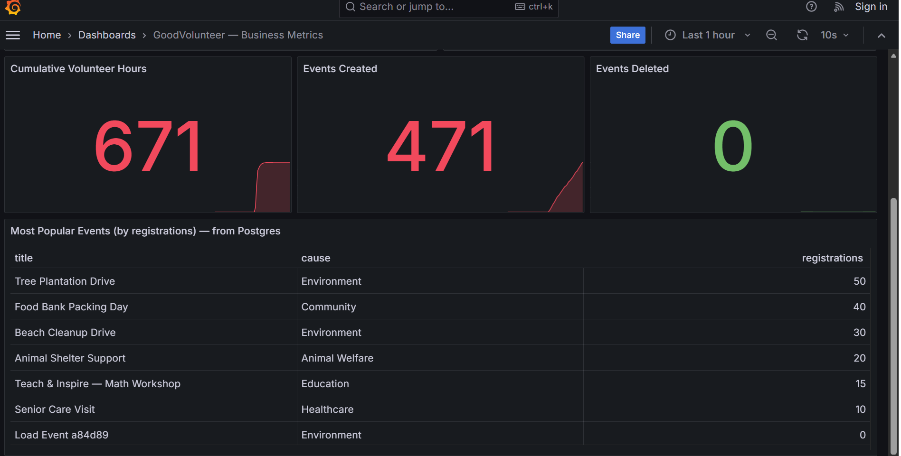
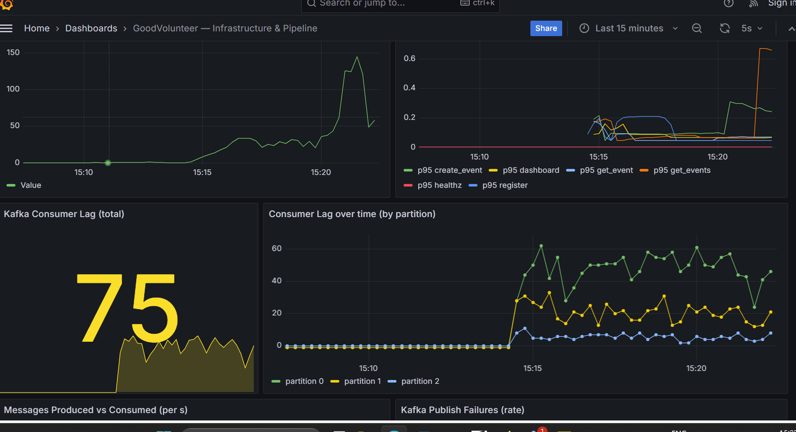
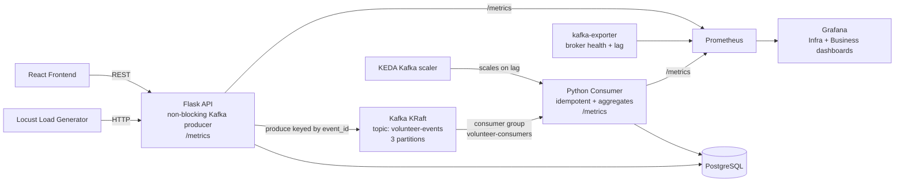

# GoodVolunteer — Event-Driven Observability Pipeline

An event-driven, fully observable rebuild of the **GoodVolunteer** employee-volunteering
portal. It demonstrates **Kafka (KRaft)**, **Docker**, **Kubernetes**, **KEDA autoscaling**,
**Prometheus**, and **Grafana** end to end — built as an interview showcase.

Every meaningful user action (browse, register, create/delete event) is published to Kafka
as a standard event, an idempotent Python consumer aggregates those events into PostgreSQL,
and Grafana visualizes both **business** metrics (registrations, causes, volunteer hours)
and **infrastructure** metrics (request rate, latency, Kafka consumer lag).

---

## Screenshots

### Grafana — Infrastructure & Pipeline (request rate, latency, Kafka consumer lag)


### Grafana — Business Metrics (registrations, causes, volunteer hours) + Locust load


---

## Architecture



### Event envelope
Every Kafka message uses one fixed shape:
```json
{
  "event_id": "uuid4",
  "event_type": "volunteer.registered | event.created | event.viewed | event.updated | event.deleted | event.list_viewed",
  "occurred_at": "ISO-8601 UTC",
  "schema_version": "1.0",
  "payload": { "...": "type-specific fields" }
}
```
Messages are **keyed by the volunteering event id** so all messages for one event land in
the same partition and stay ordered.

---

## Quick start (Docker Compose — one command)

```bash
docker compose up --build
```

Then open:

| Service | URL |
|---|---|
| Frontend (React) | http://localhost:3000 |
| API | http://localhost:5000/api/events |
| API metrics | http://localhost:5000/metrics |
| Consumer metrics | http://localhost:8001/metrics |
| Prometheus | http://localhost:9090 |
| Grafana (admin/admin) | http://localhost:3001 |
| Locust UI | http://localhost:8089 |
| kafka-exporter | http://localhost:9308/metrics |

### Expected output
- `kafka-init` logs `Topic ready:` with **3 partitions** for `volunteer-events`.
- API `/metrics` shows `flask_http_request_total` climbing as you browse.
- After registering a volunteer, the **consumer** logs `processed` and
  `http://localhost:8001/metrics` shows `consumer_registrations_total` increase.
- In Grafana, the **Infrastructure** dashboard shows request rate and **consumer lag**;
  the **Business** dashboard shows registrations, causes, and cumulative hours.

### Generate load for a live demo
Open Locust at http://localhost:8089, set users (e.g. 50) and spawn rate (e.g. 5), start —
then watch all Grafana panels and the consumer-lag panel move.

---

## Run on Kubernetes (local: minikube / kind)

```bash
# 1. Build images into the cluster (minikube example)
eval $(minikube docker-env)
docker build -t goodvolunteer/api:latest ./backend
docker build -t goodvolunteer/consumer:latest ./consumer
docker build -t goodvolunteer/locust:latest ./load-generator

# 2. Install KEDA (once)
helm repo add kedacore https://kedacore.github.io/charts && helm repo update
helm install keda kedacore/keda --namespace keda --create-namespace

# 3. Apply manifests in order
kubectl apply -f k8s/

# 4. Watch everything come up
kubectl get pods -n goodvolunteer -w

# 5. Reach Grafana / Locust (NodePorts)
minikube service grafana -n goodvolunteer   # Grafana  (NodePort 30001)
minikube service locust  -n goodvolunteer   # Locust   (NodePort 30089)
```

### Headline demo — KEDA lag-based autoscaling
1. Start a heavy load in Locust (e.g. 200 users).
2. Consumer lag rises (watch the Grafana infra dashboard).
3. KEDA scales the consumer Deployment **1 → 3** automatically:
   ```bash
   kubectl get pods -n goodvolunteer -l app=consumer -w
   ```
4. Lag drops as the three consumers share the three partitions.
5. Stop the load; after the cooldown, KEDA scales back to 1.

> **Max replicas = 3 on purpose** — the topic has 3 partitions, and a consumer group can
> only parallelize up to the partition count. A 4th consumer would sit idle.

---

## Tests

```bash
pip install -r tests/requirements.txt

# Unit tests (no Docker needed) — aggregation logic + producer fail-safe
pytest tests/test_aggregation.py tests/test_producer_failsafe.py -v

# Integration test (requires Docker) — real Kafka via Testcontainers
pytest tests/test_integration_kafka.py -v
```

Unit tests cover: registrations-per-minute bucketing, per-cause counts, cumulative hours,
idempotent dedupe, the event envelope shape, and that **publishing never raises when Kafka
is down** (the failure counter increments instead).

---

## Design notes & honest caveats

**KRaft, not ZooKeeper.** ZooKeeper was removed in Kafka 4.0, so this project runs a
single-node Kafka broker in **KRaft mode** (combined controller + broker). ZooKeeper is
kept only as a talking point — no ZooKeeper container exists here.

**Non-blocking, fail-safe publishing.** The API uses `confluent-kafka`'s async `produce()`
with a delivery callback and a short `message.timeout.ms`. If Kafka is down, the request
still succeeds; the failure is logged and counted in `kafka_publish_failures_total`.

**Idempotent consumption.** Kafka gives at-least-once delivery, so duplicates are possible.
Each `event_id` is recorded in a `processed_events` table and already-seen IDs are skipped.

**Event-loss caveat (transactional outbox).** The API commits to Postgres first, then
publishes to Kafka. If the DB commit succeeds but the publish fails, that event is lost from
the stream (the DB is still correct). The production fix is the **transactional outbox
pattern**: write the event to an `outbox` table in the same DB transaction, then relay it to
Kafka with a separate process / Debezium. This is intentionally left as a documented
trade-off to keep the demo focused.

**Single-broker Kafka in K8s is demo-only.** Production uses an HA multi-broker cluster
(e.g. the Strimzi operator). This project uses a single-broker StatefulSet to stay runnable
on a laptop.

**Backup demo video.** Live demos fail. Record a 3–4 minute screen capture of the KEDA
scaling demo (`demo/` or a link here) and keep it ready for interviews.

---

## Interview Q&A cheat-sheet

- **Why Kafka instead of calling the consumer directly?** It decouples the API from the
  consumer, absorbs bursts, and lets the consumer fall behind without hurting users.
- **What is consumer lag and why monitor it?** The gap between the latest message and the
  last one processed. Rising lag means consumers can't keep up — the signal to scale.
- **Why key by event id?** It keeps all messages for one event ordered within a partition.
- **What happens if Kafka is down?** The API still serves requests; failed publishes are
  logged and counted (`kafka_publish_failures_total`).
- **Can events be lost?** Yes — if the DB commit succeeds but the publish fails. Fix:
  transactional outbox.
- **What if the consumer sees a message twice?** It skips `event_id`s it already processed.
- **Why not scale consumers beyond the partition count?** Extra consumers sit idle.
- **Why KRaft over ZooKeeper?** ZooKeeper was removed in Kafka 4.0; KRaft is the standard.

---

## Project structure
```
res_proj/
├── backend/        Flask API: Postgres + Prometheus /metrics + Kafka producer
├── consumer/       Idempotent aggregating consumer + /metrics
├── frontend/       React UI (nginx-served)
├── load-generator/ Locust load/stress generator
├── prometheus/     Prometheus scrape config
├── grafana/        Datasource + dashboard provisioning (infra + business)
├── k8s/            Kubernetes manifests + KEDA ScaledObject
├── tests/          pytest unit tests + Testcontainers integration test
└── docker-compose.yml
```

## Tech stack
Python (Flask, confluent-kafka, prometheus-client) · PostgreSQL · Apache Kafka (KRaft) ·
Prometheus · Grafana · Docker · Kubernetes · KEDA · Locust · React
